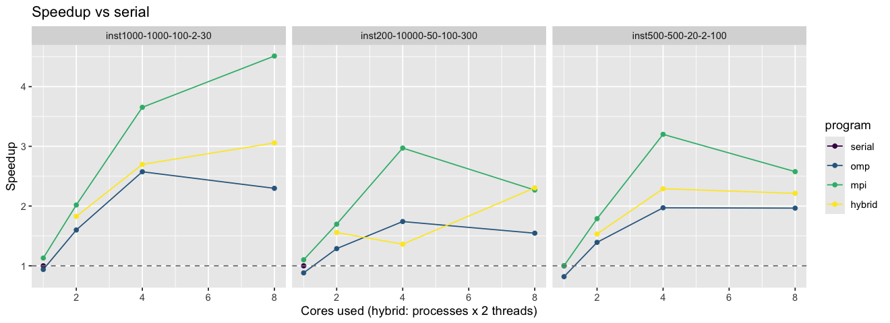

# Matrix factorisation recommender

- [x] Serial
- [x] OpenMP
- [x] MPI
- [x] MPI hybrid

A sparse user-item matrix is approximated by two dense factors. One factor has a row per user, and the other has a column per item. Gradient descent fits both factors on the observed entries. Their product gives one recommended item index per user.

## The four variants

The repository has four solvers.

- Serial is the one-process baseline, and the plot divides that time by each run.
- OpenMP runs the same factorisation on shared-memory threads, and `OMP_NUM_THREADS` sets the count.
- MPI splits the factors across processes on a 2D grid and runs one thread per process.
- MPI hybrid keeps that grid and adds OpenMP threads inside each process.

## What the speedup plot shows



Speedup in the plot is the serial end-to-end wall-clock time divided by that run's end-to-end wall-clock time. Each time is the minimum of 3 repetitions. The machine is the 10-core macOS 15.6 arm64 host recorded in `compare/data/benchmark-config.json`. That file records the measurement at commit `54b0739`. The shortest time in the files is 0.9928 s, pure MPI at 8 processes on `inst1000-1000-100-2-30`. The serial time on that instance is 4.4795 s. Pure MPI on `inst500-500-20-2-100` takes 2.6578 s at 4 processes and 3.3022 s at 8. A hybrid point uses the process count multiplied by `hybridThreadsPerRank`. The config records that multiplier as 2. Every row records `resultsAreCorrect` as 0. That column counts recommendations that differ from the instance `.out` file. A value of 0 means no mismatches.

## Build and run

To build all four solvers from the repository root, you need `g++` with OpenMP and an MPI compiler.

```sh
mkdir -p build
g++ -O3 -std=c++11 -fopenmp serial/src/*.cpp -o build/mf_serial
g++ -O3 -std=c++11 -fopenmp omp/src/*.cpp -o build/mf_omp
mpicxx -O3 -std=c++11 mpi/matFact.cpp mpi/src/*.cpp -o build/mf_mpi
mpicxx -O3 -std=c++11 -fopenmp mpi-hybrid/matFact.cpp mpi-hybrid/src/*.cpp -o build/mf_mpi_hybrid
```

These are the release commands in `.github/workflows/benchmark.yml`. Serial links OpenMP because it calls `omp_get_wtime`. The factorisation stays on one thread.

```sh
./build/mf_serial instances/inst0.in
OMP_NUM_THREADS=4 ./build/mf_omp instances/inst0.in
mpirun -np 4 ./build/mf_mpi instances/inst0.in
OMP_NUM_THREADS=2 mpirun -np 2 ./build/mf_mpi_hybrid instances/inst0.in
```

Each command prints one item index per user. `instances/inst0.out` is the reference for that input. CI configures each directory with CMake and runs that directory's tests. Build and run details for the two MPI solvers are in their READMEs.

## Write-ups

Serial and OpenMP are written up in their reports. The MPI solvers each have a README and a report.

- [Serial report](serial/report/main.pdf)
- [OpenMP report](omp/report/main.pdf)
- [Pure MPI](mpi/README.md) and [its report](mpi/report/main.pdf)
- [MPI hybrid](mpi-hybrid/README.md) and [its report](mpi-hybrid/report/main.pdf)
